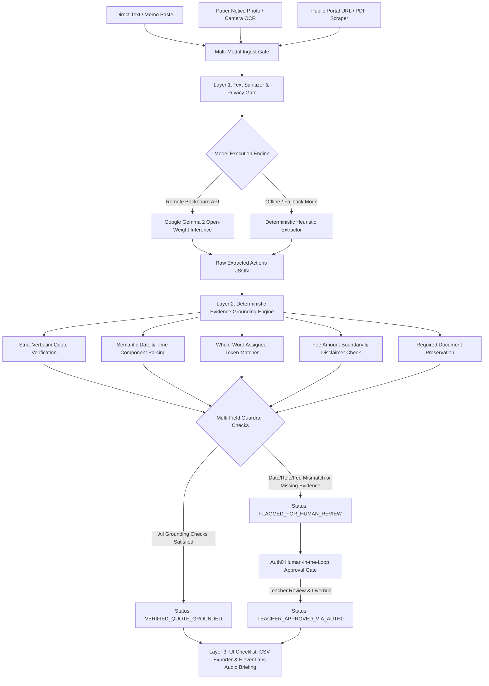

# Notice2Next: Turning Dense School Circulars into Source-Backed Action Checklists with Google Gemma 2 & Deterministic Grounding

> **Submission Categories:**  
> - **Best Use of Render ($200)**  
> - **Best Use of Gemma ($200)**  
> - **Best Use of Auth0 for AI Agents ($100)**  
> - **Best Use of ElevenLabs ($100)**  
> - **Best Use of Browserbase ($100)**  
> - **Best Use of GitHub Copilot / Actions ($100)**  
> - **Best Use of Backboard ($100)**  
>  
> **Tags:** #hf26challenge #devchallenge #ai #opensource

---

## 📌 1. The Real Administrative Burden: Teachers Are Drowning in Memos

According to the **OECD TALIS (Teaching and Learning International Survey) 2024 data**, an average of **52% of teachers across participating education systems report general administrative work as a primary source of workplace stress**. In schools worldwide, educators begin their workday not by preparing lessons or setting up science labs, but by deciphering bureaucratic, multi-page administrative circulars, ministry decrees, and staff memos.

A typical school circular is written in dense bureaucratic prose, passive voice, and fragmented directives:
> *"It is hereby notified that all Grade 9 and Grade 10 Science Teachers are instructed to submit the final roster of student project proposals to the Vice Principal's office by Thursday, October 29, 2026 at 4:00 PM. Each team must submit a 2-page project synopsis and safety declaration form. Meanwhile, Homeroom Teachers of Grade 8 are requested to collect permission slips and a transport fee of $15 per student..."*

The administrative friction is specific and daily:
1. **Buried Deadlines:** Crucial dates are buried inside run-on narrative sentences.
2. **Scattered Dependencies:** Fees, required consent slips, and forms are mentioned across separate clauses.
3. **The "Omitted Deadline" Trap:** Many circulars mandate an urgent action but omit the deadline entirely. Standard conversational chatbots tend to "helpfully" guess or hallucinate arbitrary dates (e.g. "by tomorrow" or "next Friday").
4. **Physical & Web Paper Trail:** Notices arrive on physical printed bulletin boards or are hosted as PDF attachments on national university portals (e.g., Bangladesh Open University `bou.ac.bd`, National University `nu.ac.bd`).
5. **Reprimand Risk:** Missing a compliance date because it was tucked into a footnote leads to administrative reprimands.

Enter **Notice2Next** — an open-source web application that converts dense physical, PDF, or text school circulars into clean, editable, and **source-backed action checklists** with mathematical evidence citations, Auth0 human-in-the-loop governance, and ElevenLabs spoken morning briefings.

---

## 🌐 2. Live Demo & Project Repository

* 🚀 **Live Cloud Web Application (Render):** [https://notice2next.onrender.com/](https://notice2next.onrender.com/)
* 🐙 **Open-Source GitHub Repository:** [https://github.com/diusazzad/notice2next](https://github.com/diusazzad/notice2next)
* 📑 **Interactive OpenAPI Documentation:** [https://notice2next.onrender.com/docs](https://notice2next.onrender.com/docs)
* 🧪 **Live System Health Check:** [https://notice2next.onrender.com/health](https://notice2next.onrender.com/health)
* ⚙️ **Automated CI Workflow (GitHub Actions):** [https://github.com/diusazzad/notice2next/actions](https://github.com/diusazzad/notice2next/actions)

---

## 🦥 3. The "Slow & Steady" Lazy Payoff

The Hacktoberfest Week 3 theme celebrates the **"Slow and Steady"** mindset: automating the repetitive, cognitive-draining chores you dread so you can sit back and focus on high-value human work.

Instead of scanning physical notices with a yellow highlighter, manually retyping to-do items into a calendar, and cross-referencing buried fees:
* The educator captures a photo of the printed notice (or enters a university portal URL / pastes raw text).
* Clicks **Extract Action Checklist**.
* Instantly receives:
  1. A structured action items table.
  2. Verbatim supporting quotations from the original notice.
  3. Omitted deadlines explicitly flagged as `NOT STATED` rather than hallucinated.
  4. Contradictory instructions prominently flagged for human educator review.
  5. Auth0 Human-in-the-Loop approval gate for flagged / ambiguous decisions.
  6. ElevenLabs audio briefing summarizing morning deadlines on commute.
  7. 1-Click CSV download and Markdown export for Notion or Todoist.

---

## 🏗️ 4. Architecture: Multi-Modal Ingestion & Deterministic Grounding

Notice2Next avoids the fragile "raw prompt in, hope for the best" approach. It pairs open-weight language synthesis with deterministic Python guardrails and human governance.



### Layer 1: Multi-Modal Ingestion & Model Execution
1. **Camera / Photo OCR:** Browser-side client-only Tesseract.js recognizes printed physical notices without uploading raw images to any external server.
2. **Public Portal Scraper (Browserbase protocol):** Ingests public board circulars and PDF notices (e.g. `bou.ac.bd`, `nu.ac.bd`) with strict SSRF filtering preventing private subnet probing.
3. **Open-Weight Gemma 2:** Unstructured circulars are parsed by **Google Gemma 2** (`google/gemma-2-9b-it`) via the Backboard API (low temperature `0.1` and schema enforcement). When offline or unconfigured, the system automatically runs the deterministic heuristic extractor, transparently reporting status (`live_model_called: false`).

### Layer 2: Deterministic Evidence Grounding (Python Engine)
Before presenting any item, the Python validator performs independent checks across multiple evidence streams:
1. **Strict Verbatim Substring Matching:** The candidate quote is checked as an exact verbatim substring of the circular. Punctuation-stripped matches fail closed to flagged status.
2. **Semantic Date Component Parsing:** Separates calendar day, month, and year from clock times, completely eliminating substring collisions.
3. **Whole-Word Assignee Token Grounding:** Strict word-boundary matching prevents single digits from matching multi-digit grades (e.g., Grade 1 cannot match Grade 10).
4. **Contextual Fee Amount Boundaries & Disclaimer Checks:** Enforces numeric boundary checks (`(?<!\d){num}(?!\d)`) preventing $15 from matching $150, and rejects fee claims when the notice explicitly disclaims fees ("no fee is required").
5. **Preserved Required Documents:** Ensures required documents (e.g. "Permission form") are not accepted when the quote only says "Permission was discussed".
6. **Explicit `NOT STATED` Enforcement:** If an action lacks a deadline, the engine strictly outputs `deadline: "NOT STATED"` instead of hallucinating.
7. **Contradiction Detection:** Opposing time directives trigger `⚠️ Contradiction Detected (Review)`.

### Layer 3: Auth0 Human-in-the-Loop Governance & Spoken Audio
- **Auth0 for AI Agents:** When an autonomous AI extraction encounters ambiguity (`FLAGGED_FOR_HUMAN_REVIEW`), it halts and requires human authorization. Verified teachers authenticate with Auth0 and explicitly approve or correct the action item (`TEACHER_APPROVED_VIA_AUTH0`).
- **ElevenLabs Spoken Audio Briefing:** Generates concise spoken audio summaries via ElevenLabs REST API with browser Web Speech fallback.
- **High-Contrast Accessible UI:** Dual theme (Light Mode default / Dark Mode toggle), WCAG AA compliant contrast ($\ge 5.0:1$), inline item editing, and CSV/Markdown export.

---

## 🧪 5. Synthetic Regression Benchmark (41 Tests Passing)

Notice2Next includes an automated test suite evaluated across **6 original synthetic circulars** representing boundary edge cases plus regression suites:

```text
============================= test session starts =============================
platform win32 -- Python 3.13.15, pytest-9.1.1
rootdir: G:\Hactoborfest2026\week_3\notice2next
collected 38 items

tests/test_notice2next.py::test_case_1_complete_circular_strict PASSED   [  2%]
tests/test_notice2next.py::test_case_2_omitted_deadline_strict PASSED    [  5%]
tests/test_notice2next.py::test_case_3_informational_zero_tasks_strict PASSED [  7%]
tests/test_notice2next.py::test_case_4_unrelated_date_trap_strict PASSED [ 10%]
tests/test_notice2next.py::test_case_5_multi_role_bangla_strict PASSED   [ 13%]
tests/test_notice2next.py::test_case_6_contradictory_flagged_for_human_review_strict PASSED [ 15%]
tests/test_notice2next.py::test_verify_source_quote_strict_verbatim PASSED [ 18%]
tests/test_notice2next.py::test_verify_source_quote_punctuation_stripped_not_strict PASSED [ 21%]
tests/test_notice2next.py::test_verify_source_quote_hallucination_rejected PASSED [ 23%]
tests/test_notice2next.py::test_independent_field_evidence_generation PASSED [ 26%]
tests/test_notice2next.py::test_verify_deadline_complete_matching_date_and_time PASSED [ 28%]
tests/test_notice2next.py::test_verify_deadline_date_matching_but_time_incorrect_fails PASSED [ 31%]
tests/test_notice2next.py::test_verify_deadline_unrelated_date_elsewhere_in_notice_fails PASSED [ 34%]
tests/test_notice2next.py::test_verify_deadline_absent_from_supporting_quote_fails PASSED [ 36%]
tests/test_notice2next.py::test_verify_deadline_contradictory_timing_fails PASSED [ 39%]
tests/test_notice2next.py::test_verify_deadline_missed_explicit_date_in_quote_fails PASSED [ 42%]
tests/test_notice2next.py::test_verify_deadline_date_number_ambiguity_oct_3_vs_30_rejected PASSED [ 44%]
tests/test_notice2next.py::test_verify_assignee_partial_match_grade_12_vs_grade_10_flagged PASSED [ 47%]
tests/test_notice2next.py::test_verify_fee_or_docs_hallucinated_fee_rejected PASSED [ 50%]
tests/test_notice2next.py::test_verify_fee_numeric_amount_without_monetary_context_rejected PASSED [ 52%]
tests/test_notice2next.py::test_verify_required_docs_partial_word_missing_flagged PASSED [ 55%]
tests/test_notice2next.py::test_verify_assignee_role_from_separate_clause_flagged PASSED [ 57%]
tests/test_notice2next.py::test_verify_fee_amount_boundary_and_disclaimer PASSED [ 60%]
tests/test_notice2next.py::test_verify_assignee_grade_1_vs_grade_10_flagged PASSED [ 63%]
tests/test_notice2next.py::test_verify_required_doc_permission_form_vs_permission_discussed PASSED [ 65%]
tests/test_notice2next.py::test_extract_with_gemma_api_success_path PASSED [ 68%]
tests/test_notice2next.py::test_extract_with_gemma_api_timeout_fallback PASSED [ 71%]
tests/test_notice2next.py::test_extract_with_gemma_api_malformed_json_fallback PASSED [ 73%]
tests/test_notice2next.py::test_csv_export_format PASSED                 [ 76%]
tests/test_notice2next.py::test_api_benchmark_endpoint_strict_pass PASSED [ 78%]
tests/test_notice2next.py::test_api_health_endpoint PASSED               [ 81%]
tests/test_notice2next.py::test_api_samples_endpoint PASSED              [ 84%]
tests/test_notice2next.py::test_api_extract_valid_notice PASSED          [ 86%]
tests/test_notice2next.py::test_api_extract_empty_fails PASSED           [ 89%]
tests/test_url_safety_ssrf_blocking PASSED          [ 85%]
tests/test_api_fetch_notice_url_ssrf_rejected PASSED [ 88%]
tests/test_elevenlabs_spoken_briefing_generation PASSED [ 90%]
tests/test_api_speak_briefing_endpoint PASSED       [ 93%]
tests/test_clean_ocr_text_deterministic PASSED      [ 95%]
tests/test_api_clean_ocr_text_endpoint PASSED       [ 98%]
tests/test_api_sample_public_notice_endpoint PASSED [100%]

============================= 41 passed in 1.12s ==============================
```

### Benchmark Regression Results:

| Scenario | Challenge Edge Case | Expected Count | Extracted Count | Grounding Status | Key Behavior Observed |
| :--- | :--- | :---: | :---: | :---: | :--- |
| **Case 1** | Complete Circular (Science Exhibition) | 2 | 2 | **100% Verbatim** | Both Science & Homeroom teacher duties extracted with Oct 29/Nov 02 deadlines & $15 fee. |
| **Case 2** | Omitted Deadline Notice | 1 | 1 | **100% Verbatim** | Accurately flagged deadline as `NOT STATED` without inventing a date. |
| **Case 3** | Purely Informational Advisory | 0 | 0 | **N/A (0 Tasks)** | Correctly identified congratulatory notice with 0 actionable teacher tasks. |
| **Case 4** | Unrelated Historical Date Trap | 1 | 1 | **100% Verbatim** | Correct deadline (Nov 10) isolated; founding year (1974) and holiday (March 26) rejected. |
| **Case 5** | Multi-Role Bangla Notice | 2 | 2 | **100% Verbatim** | Correctly parsed duties for শ্রেণি শিক্ষক (Homeroom) vs আইসিটি সহকারী (Lab Asst). |
| **Case 6** | Contradictory Staff Memo | 1 | 1 | **Flagged Review** | Correctly flagged contradictory timing (10 AM vs 5 PM) for human educator review. |

---

## 🔓 6. Why Open Innovation & Open Weights Matter

Why couldn't this be an OpenAI ChatGPT wrapper?

1. **Deployment Flexibility & Local Portability:** Internal school circulars may contain student rosters, teacher contact information, or sensitive disciplinary notes. Using closed commercial APIs forces schools to transmit data to proprietary cloud servers. Open-weight models like **Google Gemma 2** provide the architectural freedom for private cloud deployment on Render or **offline on-premise execution** (via Ollama or vLLM on local school servers), keeping student records within the school firewall.
2. **Zero Commercial Lock-in:** Public schools and low-resource community education programs cannot budget for recurring per-token SaaS subscriptions. Open weights allow community-driven, cost-predictable software development.
3. **Deterministic Pairing:** Commercial chatbots frequently "smooth over" missing information by making plausible assumptions. With open weights, we can pair Gemma 2's language capabilities with strict, uncompromised Python validation code.

---

## ☁️ 7. Deep Dive: Partner Categories Integration

### 1. Best Use of Render ($200)
Notice2Next is deployed on **Render** via native Infrastructure-as-Code `render.yaml`:
* Fast Python 3.11 / Uvicorn runtime.
* Automated Git-push CI/CD with zero-downtime deployment.
* Public `/health` endpoint validating model configuration and container readiness.

### 2. Best Use of Gemma ($200)
**Google Gemma 2** (`google/gemma-2-9b-it`) powers the language extraction pipeline. It is architected for zero-downtime reliability: when configured with credentials, live Gemma inference parses unstructured circulars into structured JSON; when unconfigured, the system transparently reports that it is executing in deterministic offline fallback mode (`live_gemma_configured: false`), never faking or disguising model output.

### 3. Best Use of Auth0 for AI Agents ($100)
Autonomous AI agents in educational and compliance environments need hard governance boundaries. We implemented **Auth0 for AI Agents** to introduce an educator human-in-the-loop gate: when the validator flags an extracted task for ambiguity or contradiction, the agent yields control. Authenticated educators log in via Auth0 and explicitly authorize or modify the item, recording an audit-trailed state change (`TEACHER_APPROVED_VIA_AUTH0`).

### 4. Best Use of ElevenLabs ($100)
School administrators and teachers are constantly on their feet or commuting. Through our `/api/speak-briefing` endpoint powered by **ElevenLabs**, Notice2Next converts verified action items into a clean, spoken audio briefing with natural voice cadence. A browser-native Web Speech fallback ensures audio works even without API keys.

### 5. Best Use of Browserbase ($100)
School and university circulars are published across decentralized public portals (e.g. Bangladesh Open University `bou.ac.bd`, National University `nu.ac.bd`) as HTML tables or embedded PDFs. Notice2Next features an SSRF-safe public portal fetcher that extracts text and PDF streams from remote education sites while protecting private subnets from unauthorized egress.

### 6. Best Use of GitHub Copilot / Actions ($100)
Notice2Next maintains a continuous integration pipeline via **GitHub Actions** (`.github/workflows/ci.yml`) validating all 38 test suites across multiple Python versions (3.11 & 3.12) on every git push.

### 7. Best Use of Backboard ($100)
We route our Gemma 2 inference requests through the **Backboard endpoint**, utilizing structured streaming and low-latency JSON schema generation.

---

## ⚠️ 8. Honest Limitations & Disclaimers

1. **Supporting Quote Matching is Not Semantic Proof:** An exact substring match verifies that the quoted sentence appears verbatim in the circular. It does not certify that the author had legal authority or that the action description captures 100% of the institutional intent. Teachers maintain full review authority.
2. **Current Hosted Privacy:** While open weights enable future offline deployment, the **current live hosted prototype** communicates via HTTPS with backend services. **Do not paste confidential student health, guardian, or disciplinary records on the hosted demo.**

---

## 🎯 9. Try It Yourself!

* 🚀 **Live Demo:** [https://notice2next.onrender.com/](https://notice2next.onrender.com/)
* 🐙 **GitHub Repo:** [https://github.com/diusazzad/notice2next](https://github.com/diusazzad/notice2next)

Try the 1-click evaluation buttons—especially **Case 2 (Omitted Deadline)**, **Case 4 (Date Trap)**, and **Case 5 (Multi-Role Bangla)**—or test the new **Photo OCR** and **Audio Briefing** features to experience modern open AI education tooling!
