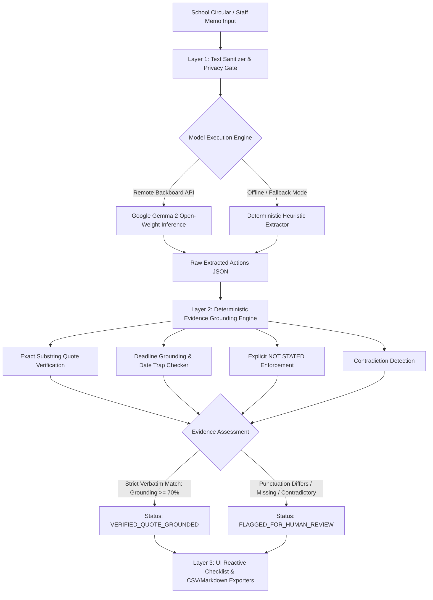

# Notice2Next: Turning Dense School Circulars into Source-Backed Action Checklists with Google Gemma 2 & Deterministic Grounding

> **Submission Category:** Best Use of Render ($200) | Best Use of Gemma ($200)  
> **Tags:** #hf26challenge #devchallenge #ai #opensource

---

## 📌 1. The Real Administrative Burden: Teachers Are Drowning in Memos

According to the **OECD TALIS (Teaching and Learning International Survey) 2024 data**, an average of **52% of teachers across participating education systems report general administrative work as a primary source of workplace stress**. In schools worldwide, educators begin their workday not by preparing lessons or setting up science labs, but by deciphering bureaucratic, multi-page administrative circulars, ministry decrees, and staff memos.

A typical school circular is written in dense bureaucratic prose, passive voice, and fragmented directives:
> *"It is hereby notified that all Grade 9 and Grade 10 Science Teachers are instructed to submit the final roster of student project proposals to the Vice Principal's office by Thursday, October 29, 2026 at 4:00 PM. Each team must submit a 2-page project synopsis and safety declaration form. Meanwhile, Homeroom Teachers of Grade 8 are requested to collect permission slips and a transport fee of $15 per student..."*

The administrative friction is specific and daily:
1. **Buried Deadlines:** Crucial dates are buried inside run-on narrative sentences.
2. **Scattered Dependencies:** Fees, required consent slips, and forms are mentioned across separate clauses.
3. **The "Omitted Deadline" Trap:** Many circulars mandate an urgent action but omit the deadline entirely. Standard conversational chatbots tend to "helpfully" guess or hallucinate arbitrary dates (e.g. "by tomorrow" or "next Friday").
4. **Reprimand Risk:** Missing a compliance date because it was tucked into a footnote leads to administrative reprimands.

Enter **Notice2Next** — a focused, lightweight open-source prototype that converts dense English and Bangla school circulars into clean, editable, and **source-backed action checklists** with verified evidence citations.

---

## 🌐 2. Live Demo & Project Repository

* 🚀 **Live Cloud Web Application (Render):** [https://notice2next.onrender.com/](https://notice2next.onrender.com/)
* 🐙 **Open-Source GitHub Repository:** [https://github.com/diusazzad/notice2next](https://github.com/diusazzad/notice2next)
* 📑 **Interactive OpenAPI Documentation:** [https://notice2next.onrender.com/docs](https://notice2next.onrender.com/docs)
* 🧪 **Live System Health Check:** [https://notice2next.onrender.com/health](https://notice2next.onrender.com/health)

---

## 🦥 3. The "Slow & Steady" Lazy Payoff

The Hacktoberfest Week 3 theme celebrates the **"Slow and Steady"** mindset: automating the repetitive, cognitive-draining chores you dread so you can sit back and focus on high-value human work.

Instead of scanning pages with a yellow highlighter, manually retyping to-do items into a calendar, and cross-referencing buried fees:
* The educator simply pastes the circular into Notice2Next.
* Clicks **Extract Action Checklist**.
* Instantly receives:
  1. A structured action items table.
  2. Verbatim supporting quotations from the original notice.
  3. Omitted deadlines explicitly flagged as `NOT STATED` rather than hallucinated.
  4. Contradictory instructions prominently flagged for human educator review.
  5. 1-Click CSV download and Markdown export for Notion or Todoist.

---

## 🏗️ 4. 3-Layer Architecture: Deterministic Grounding First

Notice2Next avoids the fragile "raw prompt in, hope for the best" approach. It pairs open-weight language synthesis with deterministic Python guardrails.



### Layer 1: Extraction Engine (Google Gemma 2 & Heuristic Fallback)
The input circular is parsed by **Google Gemma 2** (`google/gemma-2-9b-it`) via the Backboard endpoint using a low temperature (`0.1`) and strict JSON schema enforcement.
If the API key is not configured or remote calls encounter a timeout, Notice2Next seamlessly falls back to an internal **Deterministic Heuristic Extractor**. The UI and API response always transparently disclose which engine produced the output (`live_model_called: true/false`).

### Layer 2: Deterministic Evidence Grounding (Python Engine)
Before presenting any item, the Python validator performs independent checks across multiple evidence streams:
1. **Strict Verbatim Substring Matching:** The candidate quote is checked as an exact verbatim substring of the normalized circular. If a candidate quote only matches after stripping punctuation (`PUNCTUATION_STRIPPED_WORD_MATCH`), it is **not** granted verified status; it is flagged for teacher review.
2. **Semantic Distinction:** Verifying that a quote exists in the text does **not** guarantee that the generated action verb accurately represents the school's intent. Notice2Next explicitly marks the action field: `🔍 Action Intent (Teacher Review Needed)`.
3. **Explicit `NOT STATED` Enforcement:** If an action lacks a deadline, the engine strictly outputs `deadline: "NOT STATED"` instead of hallucinating.
4. **Historical Date Trap Protection:** Circulars frequently cite founding years (e.g. *"Since our school's founding in 1974..."*) or national holiday dates. The engine verifies that context dates are not misattributed as task deadlines.
5. **Contradiction Detection:** Opposing time directives within a clause (e.g. *"submit by 10 AM, however no slips accepted before 5 PM"*) trigger `⚠️ Contradiction Detected (Review)`.

### Layer 3: High-Contrast Accessible Teacher Interface
* **Dual Theme Architecture:** Clean Light Mode default + Dark Mode toggle (WCAG AA compliant contrast $\ge 5.0:1$).
* **1-Click Synthetic Edge Case Loaders:** 6 pre-loaded scenarios to test immediate extraction.
* **Inline Editing:** Teachers can click any task description to edit it inline or check off items as they finish duties.
* **Exporters:** 1-Click CSV download (`notice2next_action_checklist.csv`) and GitHub-flavored Markdown table copy.

---

## 🧪 5. 6-Scenario Synthetic Regression Benchmark

To maintain transparency, Notice2Next includes an automated test suite evaluated against **6 original synthetic circulars** representing boundary edge cases. Every test case strictly asserts its expected task count and core traits:

```text
============================= test session starts =============================
platform win32 -- Python 3.13.15, pytest-9.1.1
rootdir: G:\Hactoborfest2026\week_3\notice2next
collected 25 items

tests/test_notice2next.py::test_case_1_complete_circular_strict PASSED   [  4%]
tests/test_notice2next.py::test_case_2_omitted_deadline_strict PASSED    [  8%]
tests/test_notice2next.py::test_case_3_informational_zero_tasks_strict PASSED [ 12%]
tests/test_notice2next.py::test_case_4_unrelated_date_trap_strict PASSED [ 16%]
tests/test_notice2next.py::test_case_5_multi_role_bangla_strict PASSED   [ 20%]
tests/test_notice2next.py::test_case_6_contradictory_flagged_for_human_review_strict PASSED [ 24%]
tests/test_notice2next.py::test_verify_source_quote_strict_verbatim PASSED [ 28%]
tests/test_notice2next.py::test_verify_source_quote_punctuation_stripped_not_strict PASSED [ 32%]
tests/test_notice2next.py::test_verify_source_quote_hallucination_rejected PASSED [ 36%]
tests/test_notice2next.py::test_independent_field_evidence_generation PASSED [ 40%]
tests/test_notice2next.py::test_verify_deadline_complete_matching_date_and_time PASSED [ 44%]
tests/test_notice2next.py::test_verify_deadline_date_matching_but_time_incorrect_fails PASSED [ 48%]
tests/test_notice2next.py::test_verify_deadline_unrelated_date_elsewhere_in_notice_fails PASSED [ 52%]
tests/test_notice2next.py::test_verify_deadline_absent_from_supporting_quote_fails PASSED [ 56%]
tests/test_notice2next.py::test_verify_deadline_contradictory_timing_fails PASSED [ 60%]
tests/test_notice2next.py::test_verify_deadline_missed_explicit_date_in_quote_fails PASSED [ 64%]
tests/test_notice2next.py::test_extract_with_gemma_api_success_path PASSED [ 68%]
tests/test_notice2next.py::test_extract_with_gemma_api_timeout_fallback PASSED [ 72%]
tests/test_notice2next.py::test_extract_with_gemma_api_malformed_json_fallback PASSED [ 76%]
tests/test_notice2next.py::test_csv_export_format PASSED                 [ 80%]
tests/test_notice2next.py::test_api_benchmark_endpoint_strict_pass PASSED [ 84%]
tests/test_notice2next.py::test_api_health_endpoint PASSED               [ 88%]
tests/test_notice2next.py::test_api_samples_endpoint PASSED              [ 92%]
tests/test_notice2next.py::test_api_extract_valid_notice PASSED          [ 96%]
tests/test_notice2next.py::test_api_extract_empty_fails PASSED           [100%]
============================= 25 passed in 0.56s ==============================
```

### Benchmark Regression Results:

| Scenario | Challenge Edge Case | Expected Count | Extracted Count | Grounding Status | Key Behavior Observed |
| :--- | :--- | :---: | :---: | :---: | :--- |
| **Case 1** | Complete Circular (Science Exhibition) | 2 | 2 | **100% Verbatim** | Both Science & Homeroom teacher duties extracted with Oct 29/Nov 02 deadlines & $15 fee. |
| **Case 2** | Omitted Deadline Notice | 1 | 1 | **100% Verbatim** | Accurately flagged deadline as `NOT STATED` without inventing a date. |
| **Case 3** | Purely Informational Advisory | 0 | 0 | **N/A (0 Tasks)** | Correctly identified congratulatory notice with 0 actionable teacher tasks. |
| **Case 4** | Unrelated Historical Date Trap | 1 | 1 | **100% Verbatim** | Correct deadline (Nov 10) isolated; founding year (1974) and holiday (March 26) rejected. |
| **Case 5** | Multi-Role Bangla Notice | 2 | 2 | **100% Verbatim** | Correctly parsed duties for শ্রেণি শিক্ষক (Homeroom) vs আইসিটি সহকারী (Lab Asst). |
| **Case 6** | Contradictory Staff Memo | 1 | 1 | **Flagged Review** | Correctly flagged contradictory timing (10 AM vs 5 PM) for human educator review. |

*Disclaimer: This benchmark measures pipeline consistency across 6 synthetic test scenarios as a deterministic regression test, not a live Gemma accuracy evaluation. It demonstrates boundary enforcement but does not represent universal accuracy across all school systems.*

---

## 🔓 6. Why Open Innovation & Open Weights Matter

Why couldn't this be an OpenAI ChatGPT wrapper?

1. **Deployment Flexibility & Local Portability:** Internal school circulars may contain student rosters, teacher contact information, or sensitive disciplinary notes. Using closed commercial APIs forces schools to transmit data to proprietary cloud servers. Open-weight models like **Google Gemma 2** provide the architectural freedom for private cloud deployment on Render or **offline on-premise execution** (via Ollama or vLLM on local school servers), keeping student records within the school firewall.
2. **Zero Commercial Lock-in:** Public schools and low-resource community education programs cannot budget for recurring per-token SaaS subscriptions. Open weights allow community-driven, cost-predictable software development.
3. **Deterministic Pairing:** Commercial chatbots frequently "smooth over" missing information by making plausible assumptions. With open weights, we can pair Gemma 2's language capabilities with strict, uncompromised Python validation code.

---

## ☁️ 7. Partner Categories Integration

### 1. Best Use of Render ($200)
Notice2Next is deployed on **Render** via native Infrastructure-as-Code `render.yaml`:
* Fast Python 3.11 / Uvicorn runtime.
* Automated Git-push CI/CD with zero-downtime deployment.
* Public `/health` endpoint validating model configuration and container readiness.

### 2. Best Use of Gemma ($200)
**Google Gemma 2** provides the core natural language understanding engine, transforming unstructured English and Bengali administrative circulars into structured JSON actions while preserving exact quotations for verification.

---

## ⚠️ 8. Honest Limitations & Disclaimers

1. **Supporting Quote Matching is Not Semantic Proof:** An exact substring match verifies that the quoted sentence appears verbatim in the circular. It does not certify that the author had legal authority or that the action description captures 100% of the institutional intent. Teachers maintain full review authority.
2. **Current Hosted Privacy:** While open weights enable future offline deployment, the **current live hosted prototype** communicates via HTTPS with backend services. **Do not paste confidential student health, guardian, or disciplinary records on the hosted demo.**
3. **No OCR in v1.0:** Version 1.0 accepts digital text. Scanned physical documents must be transcribed or OCR-processed prior to pasting.

---

## 🎯 9. Try It Yourself!

* 🚀 **Live Demo:** [https://notice2next.onrender.com/](https://notice2next.onrender.com/)
* 🐙 **GitHub Repo:** [https://github.com/diusazzad/notice2next](https://github.com/diusazzad/notice2next)

Test the 1-click evaluation buttons—especially **Case 2 (Omitted Deadline)**, **Case 4 (Date Trap)**, and **Case 5 (Multi-Role Bangla)**—to see how open AI and deterministic evidence grounding streamline school administrative workflows!
