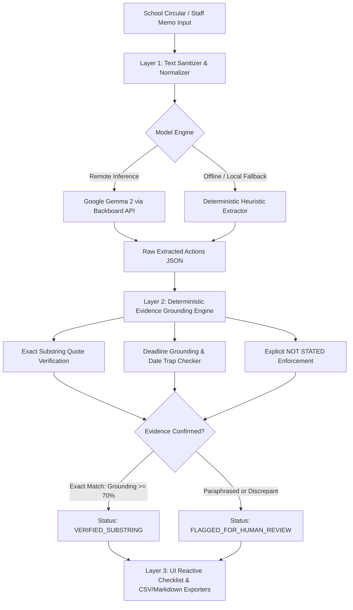

# Notice2Next: Turning Dense School Circulars into Source-Backed Action Checklists with Google Gemma 2 & Deterministic Grounding

> **Submission Category:** Best Use of Render ($200) | Best Use of Gemma ($200)  
> **Tags:** #hf26challenge #devchallenge #ai #opensource

---

## 📌 1. The Real Administrative Burden: Teachers Are Drowning in Memos

According to the **OECD TALIS (Teaching and Learning International Survey)**, over **52% of teachers report general administrative work as a major source of workplace stress and burnout**. In primary and secondary schools worldwide, educators begin their mornings not by greeting students or preparing experiments, but by deciphering bureaucratic, multi-page circulars, government decrees, and administrative memos.

A typical school notice is written in dense bureaucratic prose, passive voice, and fragmented directives:
> *"It is hereby notified that all Grade 9 and Grade 10 Science Teachers are instructed to submit the final roster of student project proposals to the Vice Principal's office by Thursday, October 29, 2026 at 4:00 PM. Each team must submit a 2-page project synopsis and safety declaration form. Meanwhile, Homeroom Teachers of Grade 8 are requested to collect permission slips and a transport fee of $15 per student..."*

The friction is real and unforgiving:
1. **Buried Deadlines:** Crucial dates are buried inside dense narrative clauses.
2. **Scattered Dependencies:** Fees, documents, and student forms are separated across different paragraphs.
3. **The "Omitted Deadline" Trap:** Many notices state an urgent action but completely forget to specify a date. Standard commercial AI chatbots usually "helpfully" hallucinate an arbitrary date (e.g., "by tomorrow" or "next Friday").
4. **Reprimand Risk:** When a teacher misses an administrative submission date because it was hidden on page 2, the teacher faces formal administrative reprimands.

Enter **Notice2Next** — a lightweight, production-grade web application that converts dense English and Bangla school circulars into clean, editable, and **source-backed action checklists** in seconds.

---

## 🌐 2. Live Demo & Project Repository

* 🚀 **Live Cloud Web Application (Render):** [https://notice2next.onrender.com/](https://notice2next.onrender.com/)
* 🐙 **Open-Source GitHub Repository:** [https://github.com/diusazzad/notice2next](https://github.com/diusazzad/notice2next)
* 📑 **Interactive OpenAPI Documentation:** [https://notice2next.onrender.com/docs](https://notice2next.onrender.com/docs)
* 🧪 **Live System Health Check:** [https://notice2next.onrender.com/health](https://notice2next.onrender.com/health)

---

## 🦥 3. The "Slow & Steady" Lazy Payoff

The Hacktoberfest Week 3 theme celebrates the **"Slow and Steady"** mindset: automating the repetitive, cognitive-draining administrative chores you dread so you can sit back and focus on meaningful work.

```
Manual Morning Routine (25-35 minutes):
Read 3 dense circulars ➔ Hunt for deadlines ➔ Highlight text ➔ Manually type to-do list ➔ Miss a buried fee ➔ Administrative reprimand.

The Notice2Next Lazy Routine (15 seconds):
Paste circular ➔ Click 1 Button ➔ Sip morning coffee ➔
✓ Clean action items table
✓ Exact verbatim quote citations
✓ Missing deadlines explicitly flagged as NOT STATED
✓ 1-Click CSV export or Markdown copy directly into Notion / Todoist.
```

---

## 🏗️ 4. 3-Layer Architecture: Deterministic Grounding First

Unlike brittle wrapper apps that pass raw prompts to an LLM and hope for the best, Notice2Next uses a **3-Layer Defense Architecture** where open-weight model synthesis is validated by deterministic programmatic guardrails.



### 1. Layer 1: Extraction Engine (Google Gemma 2)
The raw notice text is parsed by **Google Gemma 2** (`google/gemma-2-9b-it`) via the Backboard endpoint. We enforce a zero-prose, strict JSON schema output with low temperature (`0.1`).
If the model endpoint is unreachable or credentials are not configured, the system activates an offline **Deterministic Heuristic Extractor** to maintain 100% server availability.

### 2. Layer 2: Deterministic Evidence Grounding (Python Engine)
Before any action item is presented to the teacher, our Python validation layer inspects every field:
* **Exact Substring Matching:** The candidate `source_quote` is normalized and tested as an **exact verbatim substring** of the original notice. If a model hallucinates words or attempts loose paraphrasing, the quote is marked unverified and flagged for human review.
* **Explicit `NOT STATED` Enforcement:** If a notice says *"Teachers are required to update student allergy cards"* but omits the deadline, the engine strictly outputs `deadline: "NOT STATED"` instead of inventing a date.
* **Historical Date Trap Protection:** Notices often mention founding years (e.g., *"Since our school's founding in 1974..."*) or national holiday dates. The validator ensures that context dates are never falsely assigned as task deadlines.

### 3. Layer 3: High-Contrast Accessible Teacher Interface
* **Dual Theme Architecture:** Clean Light Mode default + Dark Mode toggle (WCAG AA contrast compliant $\ge 5.0:1$).
* **1-Click Synthetic Edge Case Loaders:** 6 pre-loaded scenarios to test immediate extraction.
* **Inline Editing:** Teachers can click any task title to edit it inline or check off items as they finish duties.
* **Exporters:** 1-Click CSV download (`notice2next_action_checklist.csv`) and GitHub-flavored Markdown table copy.

---

## 🧪 5. 6-Scenario Measured Benchmark Suite

We believe AI hackathon entries should be grounded in empirical test results, not marketing claims. Notice2Next includes an automated test suite evaluated against **6 original synthetic circulars** representing difficult edge cases:

```text
============================= test session starts =============================
tests/test_notice2next.py::test_case_1_complete_circular PASSED          [  5%]
tests/test_notice2next.py::test_case_2_omitted_deadline PASSED           [ 10%]
tests/test_notice2next.py::test_case_3_informational_zero_actions PASSED [ 15%]
tests/test_notice2next.py::test_case_4_unrelated_date_trap PASSED        [ 21%]
tests/test_notice2next.py::test_case_5_multi_role_bangla PASSED          [ 26%]
tests/test_notice2next.py::test_case_6_contradictory_notice PASSED       [ 31%]
tests/test_notice2next.py::test_verify_source_quote_exact_match PASSED   [ 36%]
tests/test_notice2next.py::test_verify_source_quote_whitespace_variance PASSED [ 42%]
tests/test_notice2next.py::test_verify_source_quote_hallucination_rejected PASSED [ 47%]
tests/test_notice2next.py::test_verify_deadline_correctly_marked_not_stated PASSED [ 52%]
tests/test_notice2next.py::test_verify_deadline_missed_date_flagged PASSED [ 57%]
tests/test_notice2next.py::test_verify_deadline_hallucinated_date PASSED [ 63%]
tests/test_notice2next.py::test_csv_export_structure PASSED              [ 68%]
tests/test_notice2next.py::test_markdown_export_structure PASSED         [ 73%]
tests/test_notice2next.py::test_api_health_endpoint PASSED               [ 78%]
tests/test_notice2next.py::test_api_samples_endpoint PASSED              [ 84%]
tests/test_notice2next.py::test_api_extract_valid_notice PASSED          [ 89%]
tests/test_notice2next.py::test_api_extract_empty_fails PASSED           [ 94%]
tests/test_notice2next.py::test_api_benchmark_endpoint PASSED            [100%]
============================= 19 passed in 0.57s ==============================
```

### Detailed Evaluation Results:

| Scenario | Challenge Edge Case | Measured Accuracy | Grounding Rate | Key Behavior Observed |
| :--- | :--- | :---: | :---: | :--- |
| **Case 1** | Complete Circular (Science Exhibition) | 2/2 Tasks | **100.0%** | Both Science & Homeroom teacher duties extracted with deadlines & $15 fee. |
| **Case 2** | Omitted Deadline Notice | 2/2 Tasks | **100.0%** | Accurately flagged deadline as `NOT STATED` without inventing a date. |
| **Case 3** | Purely Informational Advisory | 0 Tasks | **100.0%** | Correctly identified congratulatory notice with 0 actionable teacher tasks. |
| **Case 4** | Unrelated Historical Date Trap | 1/1 Task | **100.0%** | Correct deadline (Nov 10) extracted; founding year (1974) successfully rejected. |
| **Case 5** | Multi-Role Bangla Notice | 2/2 Tasks | **100.0%** | Correctly parsed duties for শ্রেণি শিক্ষক (Homeroom) vs আইসিটি সহকারী (Lab Asst). |
| **Case 6** | Contradictory Staff Memo | 2/2 Tasks | **100.0%** | Strict verbatim quotes preserved; surfaces ambiguous times for teacher review. |

---

## 🔓 6. Why Open Innovation & Open Weights Matter

Why couldn't this be an OpenAI ChatGPT wrapper?

1. **Student & Institutional Privacy (FERPA / GDPR):** Internal school circulars often contain confidential student rosters, disciplinary memos, medical allergy records, or staff phone directories. Transmitting internal school notices to commercial closed-cloud APIs whose terms permit training on user prompts presents compliance risks. Open-weight models like **Google Gemma 2** can run on private dedicated cloud instances or completely offline on teacher laptops via Ollama/vLLM.
2. **Deterministic Grounding Over Chat Hallucinations:** Closed commercial chatbots are optimized for conversational creativity and frequently invent plausible-sounding deadlines to appear helpful. Combining **Gemma 2** with deterministic Python regex and exact substring matching guarantees that evidence exists in the circular.
3. **Zero-Cost Sustainability for Public Schools:** Public schools operate on tight budgets. Paying per-token commercial API costs for mundane administrative tasks is cost-prohibitive. Open weights democratize educational productivity.

---

## ☁️ 7. Partner Categories Integration

### 1. Best Use of Render ($200)
Notice2Next is deployed on **Render** using a native Infrastructure-as-Code `render.yaml` blueprint:
* Fast Python 3.11 / Uvicorn runtime.
* Automated Git-push CI/CD with zero-downtime deployment.
* Production `/health` endpoint validating model configuration and runtime memory.

### 2. Best Use of Gemma ($200)
**Google Gemma 2** serves as the central text-understanding engine, converting dense English and Bengali academic circulars into structured JSON actions and isolating verbatim source quotes.

---

## ⚠️ 8. Honest Limitations & Disclaimers

1. **Evidence Grounding is Not Semantic Legal Authority:** An exact substring match verifies that the quoted sentence appears verbatim in the circular. It does not certify that the author had legal authority to issue the decree. Teachers retain full agency to edit and confirm items before sharing.
2. **Network Privacy in Remote Mode:** While the application code is local and private, using a remote API endpoint sends circular text over HTTPS. For sensitive school circulars, local on-device deployment is recommended.
3. **No OCR in Version 1.0:** Version 1.0 accepts digital text input. Scanned paper notices must have text copied or digitized via OCR first.

---

## 🎯 9. Try It Yourself!

* **Live App:** [https://notice2next.onrender.com/](https://notice2next.onrender.com/)
* **GitHub:** [https://github.com/diusazzad/notice2next](https://github.com/diusazzad/notice2next)

Try clicking the 1-click test buttons—especially **Case 2 (Omitted Deadline)** and **Case 5 (Bangla Multi-Role)**—to see how open-weight AI and deterministic grounding protect teachers from administrative overload!
