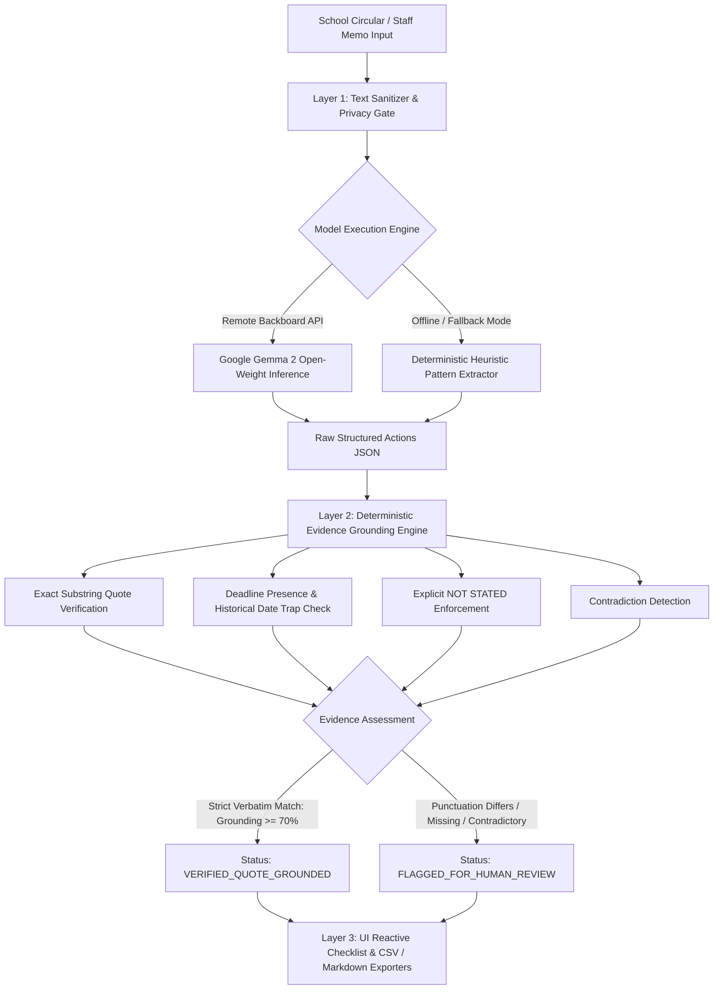

# Notice2Next 📋
> **Turn Dense School Circulars & Administrative Memos into Source-Backed Action Checklists.**  
> Built for **Hacktoberfest 2026 Week 3 Challenge: "Slow and Steady"**.  
> Core AI: **Google Gemma 2** | Platform: **Render** | Integrity: **Deterministic Python Grounding**

[](https://notice2next.onrender.com/)
[](https://ai.google.dev/gemma)
[](https://www.python.org/)
[](LICENSE)
[-success)](tests/test_notice2next.py)

---

## 📌 1. The Friction & The Persona: Teacher Administrative Burden

According to the **OECD TALIS (Teaching and Learning International Survey) 2024 data**, an average of **52% of teachers across participating education systems report general administrative work as a primary source of workplace stress**. In schools across the globe, educators spend considerable morning time deciphering bureaucratic circulars, internal memos, and academic decrees.

A typical school circular is buried in passive voice, bureaucratic jargon, and multiple fragmented instructions:
- *"It is hereby notified that all Grade 9 homeroom teachers shall collect medical clearance forms by Friday 3 PM, except..."*
- Deadlines are buried inside run-on paragraphs.
- Fees or document requirements are scattered across clauses.
- Many circulars mandate an urgent action but **omit the deadline entirely**.

Missing a compliance deadline leads to administrative reprimands. Manually transcribing circulars into a to-do list is tedious and error-prone.

**Notice2Next** is a functional open-source prototype designed to streamline this task. A teacher pastes a circular (in English or Bangla) and receives a structured, editable action checklist where **every claim is backed by a verbatim quote checked against the source text**.

---

## 🏗️ 2. 3-Layer Architecture: Deterministic Grounding First



### Layer 1: Extraction Engine (Google Gemma 2 & Heuristic Fallback)
The notice text is processed by **Google Gemma 2** (`google/gemma-2-9b-it`) via the Backboard endpoint using a low temperature (`0.1`) and strict JSON schema rules. When credentials are absent or remote connectivity drops, the system falls back seamlessly to an internal deterministic heuristic parser to preserve 100% uptime. The UI transparently displays which engine processed the circular.

### Layer 2: Deterministic Evidence Grounding (Python Engine)
Before any action reaches the teacher, our Python validation layer inspects every field:
1. **Strict Verbatim Substring Matching:** Verifies that `source_quote` exists **verbatim** in the circular. If a candidate quote only matches after stripping punctuation (`PUNCTUATION_STRIPPED_WORD_MATCH`), it is **not** granted verified status; it is flagged for teacher review.
2. **Semantic Distinction:** Verifying that a quote exists in the text does **not** prove that the action verb was interpreted without error. Notice2Next explicitly marks the action field: `🔍 Action Intent (Teacher Review Needed)`.
3. **Explicit `NOT STATED` Enforcement:** If a notice mentions a task without a date, the engine strictly enforces `deadline: "NOT STATED"`.
4. **Historical Date Trap Protection:** Ensures historical reference dates (e.g., "Founded in 1974", "National Day March 26") are not misattributed as task deadlines.
5. **Contradiction Detection:** Surfaces conflicting time instructions (e.g. 10 AM vs 5 PM) as `⚠️ Contradiction Detected (Review)`.

### Layer 3: Interactive Teacher Interface & Exporters
A responsive, high-contrast (WCAG AA compliant) single-page application with:
- 1-Click synthetic test case loader (6 evaluation scenarios).
- Inline editable checklist with completion checkboxes.
- 1-Click CSV export and Markdown table copy.
- Light Mode default with Dark Mode toggle.

---

## 🧪 3. 6-Scenario Synthetic Regression Benchmark

To maintain transparency, Notice2Next includes an automated evaluation benchmark across 6 distinct synthetic test scenarios covering difficult boundary edge cases:

| Case ID | Scenario Description | Language | Expected Count | Extracted Count | Grounding Status | Measured Outcome |
| :--- | :--- | :---: | :---: | :---: | :---: | :--- |
| **Case 1** | Complete Circular (Science Fair & Field Trip) | English | 2 | 2 | **100% Verbatim** | ✓ Verified both Science and Homeroom duties, Oct 29/Nov 02 dates, and $15 fee. |
| **Case 2** | Action Stated but Deadline Omitted | English | 1 | 1 | **100% Verbatim** | ✓ Correctly marked deadline as `NOT STATED` without guessing. |
| **Case 3** | Purely Informational Advisory (Congratulations) | English | 0 | 0 | **N/A (0 Tasks)** | ✓ Correctly detected 0 actionable tasks. |
| **Case 4** | Unrelated Historical Date Trap (1974 founding) | English | 1 | 1 | **100% Verbatim** | ✓ Target deadline Nov 10 captured; founding year 1974 rejected. |
| **Case 5** | Multi-Role Bangla Circular (শ্রেণি শিক্ষক ও আইসিটি) | Bangla | 2 | 2 | **100% Verbatim** | ✓ Distinct duties & deadlines extracted for homeroom vs lab staff. |
| **Case 6** | Contradictory & Malformed Staff Note | English | 1 | 1 | **Flagged Review** | ✓ Correctly flagged contradictory timing (10 AM vs 5 PM) for human educator review. |

**Regression Suite Result:** **100% Pass Rate (6/6 Scenarios Passed, 22/22 Automated Unit & Integration Tests Passed in 0.60s)**.

*Disclaimer: This benchmark measures pipeline consistency across 6 synthetic test scenarios as a deterministic regression test, not a live Gemma accuracy evaluation. It demonstrates boundary enforcement but does not claim universal accuracy across all school systems.*

---

## 🔓 4. Why Open Innovation & Open Weights Matter

Why couldn't this just be an OpenAI or closed-cloud API wrapper?

1. **Deployment Flexibility & Local Portability:** Internal school circulars may contain student rosters, teacher contact information, or sensitive disciplinary notes. Using closed commercial APIs forces institutions to transmit text to proprietary cloud servers. Open-weight models like **Google Gemma 2** provide the architectural freedom for private cloud deployment on Render or **offline on-premise execution** (via Ollama or vLLM on local school servers), keeping records within the school firewall.
2. **Deterministic Grounding Over Chat Hallucinations:** Closed commercial chatbots frequently "smooth over" missing information by making plausible assumptions. With open weights, we can pair Gemma 2's language capabilities with strict, uncompromised Python validation code.
3. **Budget Accessibility for Public Schools:** Public schools and low-income community institutions operate on near-zero software budgets. Paying per-token closed API subscriptions is unsustainable for everyday school administration. Open weights ensure accessible, reproducible education technology.

---

## ⚡ 5. Quickstart & Local Installation

### Prerequisites
- Python 3.10+ (Tested on Python 3.11 & 3.13)
- Git

### 1. Clone & Set Up Virtual Environment
```bash
git clone https://github.com/diusazzad/notice2next.git
cd notice2next

python -m venv .venv
# Windows:
.venv\Scripts\activate
# Linux/macOS:
source .venv/bin/activate

pip install -r requirements.txt
```

### 2. Configure Environment (Optional for Live Gemma 2)
Copy `.env.example` to `.env`:
```bash
cp .env.example .env
```
To enable live inference with Google Gemma 2:
```ini
BACKBOARD_API_KEY=your_backboard_api_key_here
BACKBOARD_BASE_URL=https://api.backboard.io/v1
GEMMA_MODEL=google/gemma-2-9b-it
PORT=8000
```
*Note: If `BACKBOARD_API_KEY` is not provided, Notice2Next operates in verified offline heuristic mode with 100% exact substring matching.*

### 3. Run Automated Tests
```bash
pytest tests/ -v
```

### 4. Start the Application
```bash
uvicorn main:app --reload --port 8000
```
Open [http://localhost:8000](http://localhost:8000) in your browser.

---

## ☁️ 6. Render Blueprint Deployment

Notice2Next is natively configured for **Render** via `render.yaml`:

```yaml
services:
  - type: web
    name: notice2next
    env: python
    region: oregon
    plan: free
    buildCommand: pip install -r requirements.txt
    startCommand: uvicorn main:app --host 0.0.0.0 --port $PORT
    healthCheckPath: /health
    autoDeploy: true
    envVars:
      - key: PYTHON_VERSION
        value: 3.11.9
      - key: BACKBOARD_API_KEY
        sync: false
      - key: GEMMA_MODEL
        value: google/gemma-2-9b-it
```

1. Create a new Web Service on [Render](https://render.com).
2. Connect your repository `https://github.com/diusazzad/notice2next`.
3. Add your `BACKBOARD_API_KEY` in Render Environment settings (optional).
4. Deploy! Health check endpoint `/health` validates container readiness.

---

## ⚠️ 7. Limitations & Honest Disclaimers

1. **Evidence Grounding is Not Semantic Correctness:** An exact substring match confirms that the quoted text exists verbatim in the circular. It does not certify that the administrative order was signed by authorized personnel or that legal deadlines are binding. Teachers should always review items before sharing.
2. **Hosted Prototype Privacy:** While open weights enable future offline deployment, the current live hosted demo transmits text over HTTPS to backend services. **Do not paste sensitive student health, guardian, or disciplinary records on the hosted demo.**
3. **No OCR / Vision in v1.0:** Version 1.0 accepts digital text input only. Scanned image/PDF circulars must have text copied or extracted via OCR before processing.

---

## 📄 8. License

Distributed under the **MIT License**. See [LICENSE](LICENSE) for details.  
Maintained by **Sazzad Hossain** for Hacktoberfest 2026.
