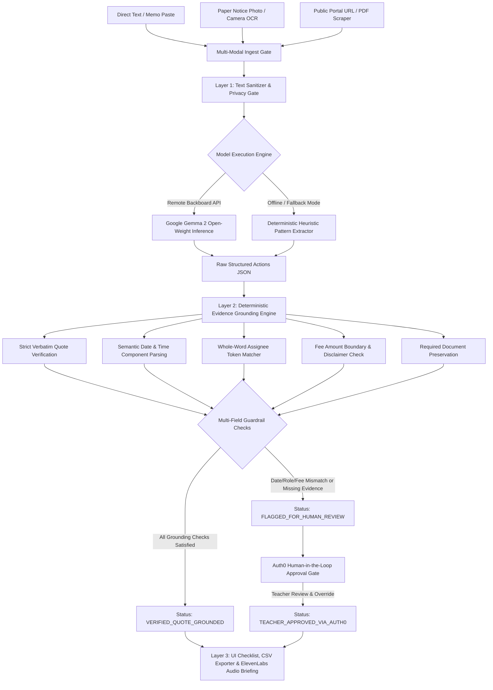

# Notice2Next 📋
> **Turn Dense School Circulars & Administrative Memos into Source-Backed Action Checklists.**  
> Built for **Hacktoberfest 2026 Week 3 Challenge: "Slow and Steady"**.  
> Core AI: **Google Gemma 2** | Platform: **Render** | Integrity: **Deterministic Python Grounding**

[](https://notice2next.onrender.com/)
[](https://ai.google.dev/gemma)
[](https://www.python.org/)
[](LICENSE)
[-success)](tests/test_notice2next.py)
[](https://github.com/diusazzad/notice2next/actions)

---

## 📌 1. The Friction & The Persona: Teacher Administrative Burden

According to the **OECD TALIS (Teaching and Learning International Survey) 2024 data**, an average of **52% of teachers across participating education systems report general administrative work as a primary source of workplace stress**. In schools across the globe, educators spend considerable morning time deciphering bureaucratic circulars, internal memos, and academic decrees.

A typical school circular is buried in passive voice, bureaucratic jargon, and multiple fragmented instructions:
- *"It is hereby notified that all Grade 9 homeroom teachers shall collect medical clearance forms by Friday 3 PM, except..."*
- Deadlines are buried inside run-on paragraphs.
- Fees or document requirements are scattered across clauses.
- Many circulars mandate an urgent action but **omit the deadline entirely**.

Missing a compliance deadline leads to administrative reprimands. Manually transcribing circulars into a to-do list is tedious and error-prone.

**Notice2Next** is a functional open-source web application designed to streamline this task:
1. **Multi-Modal Notice Ingestion:** Paste text, upload/capture physical paper circular photos with client-side **OCR (Tesseract.js)**, or fetch public portal circulars & PDFs (e.g. Bangladesh Open University `bou.ac.bd`, National University `nu.ac.bd`, or district school portals) via an SSRF-safe scraper.
2. **Deterministic Evidence Grounding:** Every action item extracted by **Google Gemma 2** is verified against the source text with mathematical boundary assertions (exact date/time matching, quote-scoped whole-word assignee tokens, and contextual fee/document validation).
3. **Auth0 for AI Agents Governance:** Ambiguous or contradictory tasks are flagged for human review. Authenticated teachers can inspect source evidence and approve items (`TEACHER_APPROVED_VIA_AUTH0`), maintaining strict human-in-the-loop governance over autonomous agent outputs.
4. **ElevenLabs Audio Briefing:** Generates an accessible, spoken morning briefing of prioritized tasks for teachers on the go.
5. **Personal Notice Library:** Saves processed notices locally for instant offline retrieval.

---

## 🏗️ 2. Architecture: Multi-Modal Ingestion & Deterministic Grounding



### Layer 1: Multi-Modal Ingestion & Extraction Engine
- **Photo / Document OCR:** Integrated browser-side Tesseract.js allows teachers to photograph printed paper notices and immediately extract clean text.
- **SSRF-Safe Public Notice Fetcher:** Fetches notices directly from university portals, board websites, and public PDFs with strict private-network / localhost blocking.
- **Model Layer:** Extracted text is processed by **Google Gemma 2** (`google/gemma-2-9b-it`) via Backboard with zero-downtime deterministic heuristic fallback.

### Layer 2: Deterministic Evidence Grounding (Python Engine)
Before any action reaches the educator, our Python validation layer inspects every field:
1. **Strict Verbatim Substring Matching:** Verifies that `source_quote` exists verbatim in the circular. Punctuation-stripped matches fail closed to flagged status.
2. **Semantic Date Component Parsing:** Separates calendar year, month, and day from clock times, eliminating substring matching collisions.
3. **Whole-Word Assignee Token Matching:** Uses word-boundary token equality (`\b\w+\b`) to prevent numeric/substring collisions (e.g., Grade 1 cannot match Grade 10).
4. **Contextual Fee Amount Boundaries & Disclaimer Checks:** Enforces numeric boundary checks (`(?<!\d){num}(?!\d)`) preventing $15 from matching $150, and rejects fee claims when the notice disclaims fees ("no fee is required").
5. **Preserved Required Documents:** Ensures core document requirements (e.g. "Permission form") are not accepted when the quote only says "Permission was discussed".
6. **Explicit `NOT STATED` Enforcement:** Missing deadlines are strictly labeled `NOT STATED` rather than hallucinated.
7. **Contradiction Detection:** Conflicting directives trigger `⚠️ Contradiction Detected (Review)`.

### Layer 3: Interactive Teacher Interface, Auth0 & Audio
- **Auth0 for AI Agents:** Enables educators to securely authenticate and serve as the human-in-the-loop decision-maker for ambiguous agent extractions.
- **ElevenLabs Audio Briefing:** Generates concise spoken audio summaries via ElevenLabs REST API with browser Web Speech fallback.
- **Export & Library:** 1-Click CSV export, Markdown table copy, and LocalStorage Personal Notice Library.

---

## 🧪 3. Synthetic Regression Benchmark (38 Tests Passing)

Notice2Next includes an automated evaluation benchmark covering difficult boundary edge cases:

| Case ID | Scenario Description | Language | Expected Count | Extracted Count | Grounding Status | Measured Outcome |
| :--- | :--- | :---: | :---: | :---: | :--- |
| **Case 1** | Complete Circular (Science Fair & Field Trip) | English | 2 | 2 | **100% Verbatim** | ✓ Verified both Science and Homeroom duties, Oct 29/Nov 02 dates, and $15 fee. |
| **Case 2** | Action Stated but Deadline Omitted | English | 1 | 1 | **100% Verbatim** | ✓ Correctly marked deadline as `NOT STATED` without guessing. |
| **Case 3** | Purely Informational Advisory (Congratulations) | English | 0 | 0 | **N/A (0 Tasks)** | ✓ Correctly detected 0 actionable tasks. |
| **Case 4** | Unrelated Historical Date Trap (1974 founding) | English | 1 | 1 | **100% Verbatim** | ✓ Target deadline Nov 10 captured; founding year 1974 rejected. |
| **Case 5** | Multi-Role Bangla Circular (শ্রেণি শিক্ষক ও আইসিটি) | Bangla | 2 | 2 | **100% Verbatim** | ✓ Distinct duties & deadlines extracted for homeroom vs lab staff. |
| **Case 6** | Contradictory & Malformed Staff Note | English | 1 | 1 | **Flagged Review** | ✓ Correctly flagged contradictory timing (10 AM vs 5 PM) for human educator review. |

**Regression Suite Result:** **100% Pass Rate (38/38 Automated Unit, SSRF & Audio Integration Tests Passed in 1.14s)**.

---

## ⚡ 4. Quickstart & Local Installation

### Prerequisites
- Python 3.10+ (Tested on Python 3.11, 3.12, 3.13)
- Git

### 1. Clone & Set Up Virtual Environment
```bash
git clone https://github.com/diusazzad/notice2next.git
cd notice2next

python -m venv .venv
# Windows:
.venv\Scripts\activate
# Linux/macOS:
source .venv/bin/activate

pip install -r requirements.txt
```

### 2. Configure Environment (Optional)
Copy `.env.example` to `.env`:
```bash
cp .env.example .env
```
Available environment variables:
```ini
BACKBOARD_API_KEY=your_backboard_api_key_here
BACKBOARD_BASE_URL=https://api.backboard.io/v1
GEMMA_MODEL=google/gemma-2-9b-it
ELEVENLABS_API_KEY=your_elevenlabs_api_key_here
ELEVENLABS_VOICE_ID=21m00Tcm4TlvDq8ikWAM
PORT=8000
```

### 3. Run Automated Tests
```bash
pytest tests/ -v
```

### 4. Start the Application
```bash
uvicorn main:app --reload --port 8000
```
Open [http://localhost:8000](http://localhost:8000) in your browser.

---

## ☁️ 5. Cloud Deployment & CI/CD

Notice2Next is natively configured for:
- **Render (`render.yaml`):** Automated container build, Uvicorn service, and `/health` monitoring.
- **GitHub Actions (`.github/workflows/ci.yml`):** Runs the full 38-test pytest suite across Python 3.11 and 3.12 on every push and pull request.

---

## ⚠️ 6. Limitations & Honest Disclaimers

1. **Evidence Grounding is Not Semantic Truth:** An exact substring match verifies that the quoted phrase appears verbatim in the circular. It does not certify that the administrative memo was authorized or legally binding.
2. **Hosted Prototype Privacy:** While open weights enable private on-premise execution, the live hosted prototype transmits text over HTTPS. **Do not paste sensitive student health or disciplinary records on the hosted public demo.**

---

## 📄 7. License

Distributed under the **MIT License**. See [LICENSE](LICENSE) for details.  
Maintained by **Sazzad Hossain** for Hacktoberfest 2026.
